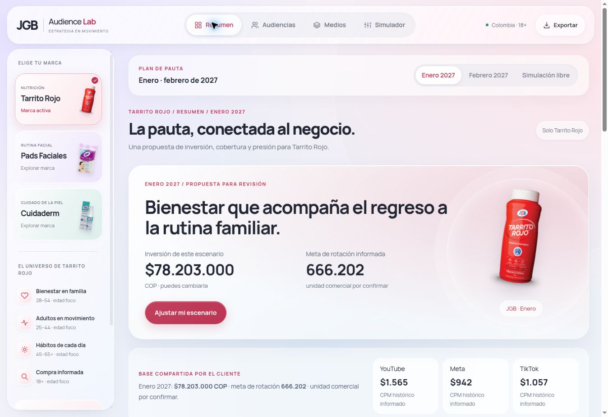

# JGB Audience Lab

Una sola aplicación con **tres espacios independientes**: Tarrito Rojo, Pads Faciales y Cuidaderm. Cada marca tiene Resumen, Audiencias, Medios y Simulador, con identidad visual y escenarios propios.

La interfaz usa una estética clara inspirada en iOS: superficies de cristal translúcido, navegación flotante, tarjetas con profundidad y un dock inferior en móvil. Incluye alternativas para movimiento reducido, mayor contraste y navegadores sin desenfoque.



## Presupuesto definido por el usuario

En **Simulación libre**, cada presupuesto inicia **vacío**. El usuario escribe el monto completo en COP; por ejemplo, `27350000` o `27.350.000`. En simulación libre no hay inversión precargada ni reparto entre marcas. Los planes de enero y febrero usan exclusivamente la inversión mensual proporcionada por el cliente, siempre editable. Los resultados permanecen pendientes hasta ingresar un monto válido. Un cero explícito produce resultados en cero.

Cambiar el presupuesto, los días, el universo, el objetivo, la mezcla o los costos de una marca no altera otra. El esquema anterior de presupuestos automáticos no se restaura. Los escenarios se guardan y comparan dentro de su propia marca, hasta seis por marca.

## Plan de enero y febrero de 2027

El correo compartido el 23 de noviembre de 2026 alimenta seis escenarios independientes. El usuario confirmó usar los valores mensuales y señalar la diferencia de Cuidaderm.

| Marca | Enero COP | Febrero COP | Rotación enero | Rotación febrero | CPM YouTube | CPM Meta | CPM TikTok |
| --- | ---: | ---: | ---: | ---: | ---: | ---: | ---: |
| Tarrito Rojo | 78.203.000 | 72.583.000 | 666.202 | 515.271 | 1.565 | 942 | 1.057 |
| Cuidaderm | 26.481.000 | 24.600.000 | 17.621 | 13.629 | 1.268 | 913 | 807 |
| Pads | 7.916.000 | 13.473.000 | 48.827 | 69.253 | 1.950 | 859 | 1.801 |

- Cuidaderm suma **$51.081.000 y 31.250 unidades**; el correo reporta $51.060.000 y 31.249. La app conserva y explica ambas cifras.
- Para Tarrito, la unidad comercial de la rotación queda por confirmar; cualquier equivalencia en unidades se marca como ilustrativa.
- Los CPM son históricos informados, usados como referencia, no tarifas garantizadas.
- El mix, bandas de frecuencia, universo, CTR, llegada a sesión, CVR y unidades por compra son hipótesis estratégicas. El CVR inicial de 1% es ilustrativo y se acompaña de sensibilidad de 0,5%, 1% y 2%.
- Compras = sesiones × CVR; unidades = compras × unidades por compra. Se muestra la equivalencia con la meta total, sin afirmar atribución ni incremento. Checkout, conversión histórica y medición del retailer están pendientes de validación.
- La distribución de rotación del brief no se usa como CVR ni como parte atribuible a pauta.
- El control de solapamiento exige **menos de 15%**, inicia sin medición y se registra por marca y mes. Un 15% exacto exige revisión. No se promete deduplicación real entre plataformas.
- Cuadro de materiales por marca y mes: 11 versiones finales propuestas, no 11 rodajes, con rol, formato, contenido, momento y KPI. Exportación CSV independiente.
- Planes bajo `jgb-campaign-2027-v1`; simulación libre bajo su clave previa. URLs: `#marca/vista/jan`, `#marca/vista/feb`, `#marca/vista/free`.

## Contenido y funciones

- Cuatro perfiles por marca, con afinidades, momentos, palabras clave, mensajes, ideas creativas, activación, exclusiones y KPI.
- Plan enero–febrero: Meta, TikTok y YouTube. Simulación libre: también conserva Google Search y Display.
- Presupuesto libre en COP, duración, universo editable y objetivos de alcance, tráfico o mezcla balanceada.
- Mezcla de medios ajustable al 100%; solo distribuye la inversión de la marca activa.
- CPM o CPC, CTR, llegada a sesión y repetición editables por canal.
- Escenarios de eficiencia prudente, base y optimista.
- Cobertura, alcance con saturación, impresiones, clics, sesiones, frecuencia y costos derivados.
- Curva acumulada, tabla de resultados, comparación, CSV e impresión.
- Navegación por teclado, filtros de audiencias y adaptación a escritorio y móvil.

## Desarrollo

HTML, CSS y módulos JavaScript sin dependencias de producción. Recursos de producto y fuentes locales.

```bash
npm run dev
npm test
npm run build
```

Vercel ejecuta la verificación estática y publica `public/`. El servidor de desarrollo acepta `--host` y `--port`.

Las pruebas verifican presupuestos vacíos, lectura de montos en COP, independencia entre marcas, ecuaciones, presupuesto cero, saturación, tasas ponderadas, redistribución y snapshots. La revisión de navegador cubre edición y recarga, escenarios por marca, exportación, búsqueda, modales y pantallas de 320 y 390 px.

## Modelo

**Universos y tasas iniciales son hipótesis editables; no son resultados medidos ni benchmarks certificados. Los costos de la simulación libre son ilustrativos. Los CPM de los planes enero–febrero proceden del correo del cliente.** La app no conecta cuentas de anuncios o GA4.

- CPM: `impresiones = inversión / CPM × 1.000`.
- `clics = impresiones × CTR / 100`.
- Search: `clics = inversión / CPC`; `impresiones = clics / (CTR / 100)`.
- `sesiones = clics × llegada a sesión / 100`.
- `contactos efectivos = suma(impresiones / repetición base de cada medio)`.
- `alcance = U × (1 − exp(−contactos efectivos / U))`.
- `cobertura = alcance / U × 100`.

El alcance aproxima la saturación dentro del universo de cada marca, bajo un supuesto homogéneo de exposición; no es una deduplicación medida. Los universos iniciales de Tarrito Rojo (8 M), Pads (4 M) y Cuidaderm (5 M) son hipótesis editables por separado. No se agregan universos ni alcances entre marcas.

Prudente: costos × 1,20, CTR × 0,80 y llegada × 0,90. Optimista: costos × 0,85, CTR × 1,15 y llegada × 1,05. Tasas limitadas al 100%; no son intervalos estadísticos. La duración cambia el ritmo diario, no el total para una misma inversión.

## Persistencia y fuentes

Configuraciones y escenarios se conservan en `localStorage`, bajo `jgb-audience-lab-v2`. No se activan campañas ni se transmite inversión a plataformas. El CSV incluye los parámetros y resultados de la marca activa. La metodología y los sitios oficiales están disponibles en la app. Créditos en `public/assets/SOURCES.md`.

Las pruebas del plan mensual verifican transcripción de montos y CPM, independencia entre meses, conciliación, conversión separada del sell-out, tratamiento del 15% exacto, conservación de supuestos y cantidades de materiales.
